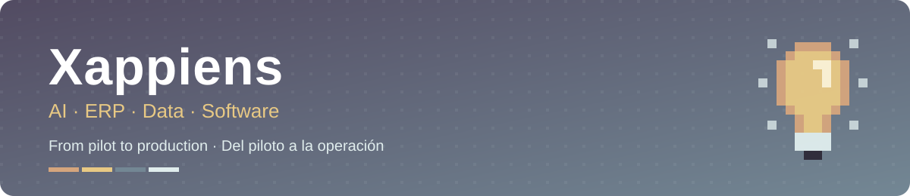

  

  
  
  
  

  <a href="#-english"><b>🇬🇧 English</b></a> &nbsp;·&nbsp; <a href="#-español"><b>🇪🇸 Español</b></a>

---

## 🇬🇧 English

**Xappiens** designs, builds and runs **AI, ERP and data solutions** so companies can move from a promising pilot to something that runs their business every day.

We are a technology consultancy from **Murcia, Spain**, with a development hub in **Ahmedabad, India**. We have spent more than 12 years putting ERPs into production, mostly in industry, and we are **Frappe partners in Spain**.

### What we do

| | |
|---|---|
| 🤖 **Artificial intelligence** | AI agents for WhatsApp, Telegram and the web · RAG over company knowledge · a managed AI platform · AI connected to your ERP and CRM |
| 🧩 **ERP & CRM** | ERPNext and Frappe implementation · Spanish accounting (PGC, SII, Verifactu) · migrations from legacy ERPs · multi-company and multi-site rollouts |
| 🧭 **Digital transformation** | Fractional / interim CTO · integration architecture (APIs, events, ETL) · cybersecurity · help with public funding programmes |
| 🛠️ **Software development** | Custom apps · dedicated teams and staff augmentation through Clicode |

### Our ecosystem

| | Company | What it does |
|---|---|---|
| 💡 | **[Xappiens](https://xappiens.com)** | Consulting, ERP implementation, AI and architecture. The team that leads the client relationship. |
| 🇮🇳 | **[Clicode](https://clicode.in)** | Our development arm in Ahmedabad: software, AI and tech outsourcing. Frappe Certified, ERPNext Partner, OVHcloud Partner, AWS Certified. |
| 🚀 | **[Keen Incubator](https://keenincubator.com)** | AI technology hub that takes startups from idea to validation: website, business model, deck and MVP. |
| 🟦 | **[Frappe España](https://frappe.es)** | ERPNext, Frappe CRM, Helpdesk and Spanish accounting for companies in Spain. |

### Open source

| Repository | Description |
|---|---|
| [**spain_compliance**](https://github.com/XappiensAI/spain_compliance) | Spanish accounting and compliance for ERPNext: Plan General Contable, credit-note series, collection statuses and an accounting UI. |
| [**frappe_mcp**](https://github.com/XappiensAI/frappe_mcp) | MCP server for stock Frappe 15. Gives AI assistants the same tools as Frappe 16, without replacing the framework. |
| [**XappiensOS**](https://github.com/XappiensAI/XappiensOS) | A free operating system based on Pop!_OS and Ubuntu 26.04 LTS (COSMIC). |

We also follow and contribute to the Frappe ecosystem: [Frappe](https://github.com/frappe/frappe), [ERPNext](https://github.com/frappe/erpnext), [LMS](https://github.com/frappe/lms) and [India Compliance](https://github.com/resilient-tech/india-compliance).

### Get in touch

📩 **info@xappiens.com** (Spain and Europe) · **tellus@clicode.in** (India and development) · 🌐 [xappiens.com](https://xappiens.com)

<a href="#-english">↑ back to top</a>

---

## 🇪🇸 Español

En **Xappiens** diseñamos, implantamos y operamos **soluciones de IA, ERP y datos** para que tu empresa pase del piloto a la operación diaria.

Somos una consultora tecnológica de **Murcia**, con un centro de desarrollo en **Ahmedabad (India)**. Llevamos más de 12 años poniendo ERPs en producción, sobre todo en la industria, y somos **partners de Frappe en España**.

### Qué hacemos

| | |
|---|---|
| 🤖 **Inteligencia artificial** | Agentes de IA en WhatsApp, Telegram y web · RAG sobre el conocimiento de tu empresa · plataforma de IA gestionada · IA conectada con tu ERP y CRM |
| 🧩 **ERP y CRM** | Implantación de ERPNext y Frappe · contabilidad española (PGC, SII, Verifactu) · migración desde ERPs antiguos · despliegues multiempresa y multiplanta |
| 🧭 **Transformación digital** | CTO fraccional o interino · arquitectura de integración (APIs, eventos, ETL) · ciberseguridad · gestión de ayudas públicas |
| 🛠️ **Desarrollo de software** | Aplicaciones a medida · equipos dedicados y refuerzo de equipo a través de Clicode |

### Nuestro ecosistema

| | Empresa | Qué hace |
|---|---|---|
| 💡 | **[Xappiens](https://xappiens.com)** | Consultoría, implantación de ERP, IA y arquitectura. Lidera la relación con el cliente. |
| 🇮🇳 | **[Clicode](https://clicode.in)** | Nuestro brazo de desarrollo en Ahmedabad: software, IA y outsourcing tecnológico. Frappe Certified, ERPNext Partner, OVHcloud Partner, AWS Certified. |
| 🚀 | **[Keen Incubator](https://keenincubator.com)** | Hub tecnológico de IA que acompaña a startups desde la idea hasta la validación: web, modelo económico, deck y MVP. |
| 🟦 | **[Frappe España](https://frappe.es)** | ERPNext, Frappe CRM, Helpdesk y contabilidad española para empresas en España. |

### Código abierto

| Repositorio | Descripción |
|---|---|
| [**spain_compliance**](https://github.com/XappiensAI/spain_compliance) | Contabilidad y cumplimiento español para ERPNext: Plan General Contable, series de abonos, estados de cobro y una interfaz contable. |
| [**frappe_mcp**](https://github.com/XappiensAI/frappe_mcp) | Servidor MCP para Frappe 15 estándar. Da a los asistentes de IA las mismas herramientas que Frappe 16, sin sustituir el framework. |
| [**XappiensOS**](https://github.com/XappiensAI/XappiensOS) | Sistema operativo libre basado en Pop!_OS y Ubuntu 26.04 LTS (COSMIC). |

También seguimos y contribuimos al ecosistema Frappe: [Frappe](https://github.com/frappe/frappe), [ERPNext](https://github.com/frappe/erpnext), [LMS](https://github.com/frappe/lms) e [India Compliance](https://github.com/resilient-tech/india-compliance).

### Contacto

📩 **info@xappiens.com** (España y Europa) · **tellus@clicode.in** (India y desarrollo) · 🌐 [xappiens.com](https://xappiens.com)

<a href="#-español">↑ volver arriba</a>

---

  
  
  
  
  
  
  
  

Made with 💡 in Murcia &amp; Ahmedabad

